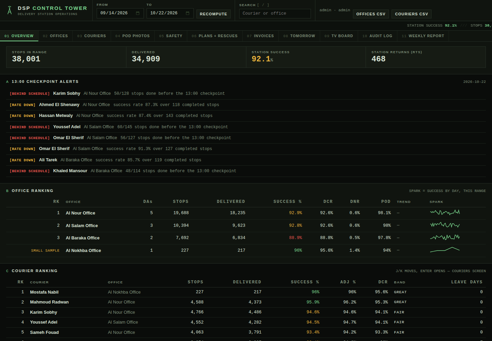

# DSP Control Tower

Built from a follow-up desk, not from a tutorial.

When you run courier follow-up for a delivery station, your day is a
spreadsheet, a phone that does not stop, and one question asked fifty
times: who is falling behind, and did anyone actually call them?
This is that desk as one system.

## How it is put together

One database, an API in the middle, and a web page on top.

```
SQLite database  <-  REST API (Python, no dependencies)  <-  browser
```

Nothing on the page talks to the database directly, and nothing in the
API knows what a phone screen looks like. That split is the whole point:
the same API that serves the station computer serves a phone browser.
Open it on a laptop, an Android phone, or an iPhone and you get the same
numbers, laid out for the screen you have. There is no app to install.

It is not deployed on the public internet. It runs locally today.
Putting it online is a hosting decision, and it has not been taken yet.

## Run it

```bash
cd backend
python3 seed.py     # builds the demo database (fictional data)
python3 app.py      # http://127.0.0.1:8077
```

Demo accounts, printed here on purpose. Change them before any real use.

| user | password | what he sees |
|---|---|---|
| admin | admin1234 | everything, including the audit trail |
| dispatcher | demo1234 | follow-up agent, Al Nour Office only |
| viewer | viewer1234 | read only, cannot write a thing |

## The shape of the operation

A station does not employ couriers directly here. Offices supply them.

```
Station -> outsourcing offices -> couriers (we call them DAs)
```

Every screen takes a date range at the top and every number below it
obeys that range. There are no hard coded "this week" numbers anywhere.

## What it tracks

Offices ranked best to worst, and inside each office its couriers ranked
best to worst. Office percentage is weighted by stops, never an average
of courier percentages. An office under 500 completed stops in the range
is shown but flagged small sample and gets no rank, because a two day
office with lucky numbers is not the best office in the station.

Each DA has a full profile: phone, vehicle, start date, his office
history with dates, his leave by type with his annual balance, and his
numbers by day. When a DA moves office, the move is dated and the old
office keeps the numbers he made while he was theirs.

Leave is a first class thing, not a note. A DA on leave drops out of
route distribution and out of the rankings for those days, and a record
typed in by mistake during his leave is ignored by every calculation.

On top of that: a 13:00 checkpoint alert list, a follow-up log per
courier and per office, Amazon's own metric language (DCR, DNR, POD
score, customer feedback), a POD photo board with a fame side and a
shame side, a safety log where every event carries a 48 hour dispute
deadline that counts down in front of you, coaching plans with review
dates, rescues with the credit going to the rescuer, an invoice check
that compares what an office billed against the courier days the system
actually recorded, a planner for tomorrow (volume in, how many DAs each
office must supply, who is on leave), a station TV board, a WhatsApp
summary text generated per office per day (text only, this system sends
nothing to anyone), and an audit trail of who changed which number from
what to what. CSV export for the offices and couriers tables, same date
range as the screen.

## Words we use, because the station uses them

- **DA** — delivery associate. The courier.
- **DSP** — the delivery company / station operation.
- **RTS** — return to station. The parcel came back with the DA.
- **DNR** — delivered, not received. Customer says it never arrived.
  One DNR hurts more than three honest failures.
- **DCR** — delivery completion rate. Delivered out of everything assigned.
- **POD** — photo on delivery, and whether the photo would survive a claim.
- **Checkpoint** — 13:00. The hour a falling day can still be saved.

## The deepening layer

Daily records arrive as a CSV import (`POST /api/import/records`) that validates its columns, refuses broken rows one by one with the row number and the reason, and names the duplicates it skipped instead of counting anything twice. The weekly report view prints clean for the station wall. An admin can take a timestamped backup of the whole database from `/api/admin/backup` and read the live configuration from `/api/admin/config`. The app writes a rotating log file next to the backend, and its port, database, log, backup folder and token lifetime all come from environment variables, listed in `config.env.example`.

To restore a backup: stop the server, copy the chosen file from the backup folder over the database path, and start the server again. Restores are a manual copy on purpose.

## Tests

```bash
python3 tests/test_metrics.py   # the arithmetic, on hand-worked numbers
python3 tests/test_api.py       # boots a real server, attacks it, uses it
python3 tests/test_deepening.py # import report, backup file, config, report shape
```

## Known limits, stated plainly

- The dispute deadline clock uses real wall clock time. The seeded
  safety events sit in October 2026, so their windows read correctly
  around those dates and read expired later. That is honest behaviour
  for real data and slightly odd for a frozen demo.
- Route difficulty weights are set by hand per route in the seed. A
  real station would argue about them for a week, then set them once.
- The WhatsApp summary is text generation only. Sending it is a human's
  job, deliberately.
- One server process holds the login tokens in memory. Restart it and
  everyone logs in again. Fine for a station, not fine for a company,
  and it is not pretending to be one.

## Layout

```
backend/    app.py (API), metrics.py (the maths), seed.py (demo data)
frontend/   index.html, a dense data terminal: English, left to right,
            hairlines instead of cards, Archivo + IBM Plex Mono
tests/      if it is not tested, it is not claimed
SECURITY.md how passwords, tokens and input are handled
CRITIQUE.md the checklist this build was judged against, with evidence
```

## Screenshots



The overview, running on the seeded demo data: checkpoint alerts at the
top, offices and couriers ranked underneath. The sign-in screen is in
[docs/screenshot-login.png](docs/screenshot-login.png). All data on
these screens is fictional demo data.
